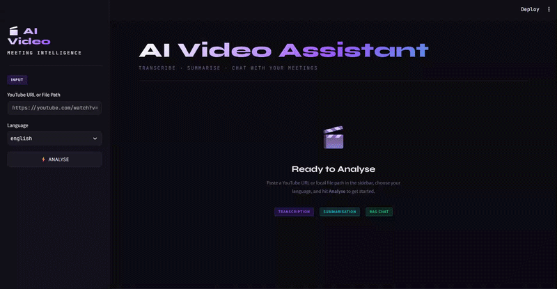

# 🧠 MeetMind AI

> **AI-powered meeting intelligence and conversational assistant for audio and video content.**

<p align="center">
  
</p>

MeetMind AI transforms long audio and video meetings into structured, searchable, and conversational knowledge.

It can take a **YouTube URL or local audio file**, transcribe the content, generate a professional meeting summary, identify action items, extract key decisions and open questions, and provide a **RAG-powered chatbot** for asking questions about the meeting.

---

## ✨ Features

* 🎥 **YouTube & Local Audio Support**
* 🎙️ **Automatic Speech-to-Text**
* 🇬🇧 **English Transcription with Faster-Whisper**
* 🇮🇳 **Hinglish Transcription with Sarvam AI**
* 📝 **AI-generated Meeting Summary**
* 🏷️ **Automatic Meeting Title Generation**
* ✅ **Action Item Extraction**
* 🔑 **Key Decision Extraction**
* ❓ **Open Question Detection**
* 🔍 **Semantic Search over Meeting Transcripts**
* 💬 **RAG-based Conversational Q&A**
* 🗄️ **Persistent Chroma Vector Database**
* 🤖 **Mistral AI for Summarization and Question Answering**

---

## 🏗️ Architecture

```text
                    YouTube / Local Audio
                            │
                            ▼
                 ┌─────────────────────┐
                 │   Audio Processor   │
                 │   yt-dlp + FFmpeg   │
                 │       + pydub       │
                 └──────────┬──────────┘
                            │
                       WAV Chunks
                            │
                            ▼
                 ┌─────────────────────┐
                 │    Transcription    │
                 │                     │
                 │ English → Whisper   │
                 │ Hinglish → Sarvam   │
                 └──────────┬──────────┘
                            │
                       Transcript
                            │
              ┌─────────────┼─────────────┐
              │             │             │
              ▼             ▼             ▼
         Summarization   Extraction      RAG
              │             │             │
              │       ┌─────┼─────┐       │
              │       │     │     │       ▼
              │       ▼     ▼     ▼   ChromaDB
              │    Actions Decisions     │
              │             Questions     ▼
              │                       Retriever
              │                           │
              ▼                           ▼
        Meeting Summary              Mistral LLM
        + Meeting Title                   │
                                          ▼
                                    Meeting Q&A
```

---

## 🔄 Processing Pipeline

### 1. Audio Processing

The system accepts:

* YouTube URLs
* Local audio files

For YouTube videos, audio is downloaded using `yt-dlp`.

The audio is then converted into:

```text
Mono
16 kHz
WAV
```

Long audio files are divided into manageable chunks before transcription.

---

### 2. Transcription

MeetMind AI supports two transcription pipelines.

#### English

```text
Audio Chunk
    ↓
Faster-Whisper
    ↓
Transcript
```

#### Hinglish

```text
Audio Chunk
    ↓
25-second Audio Pieces
    ↓
Sarvam AI
    ↓
Transcript
```

---

### 3. Meeting Summarization

The transcript is split into smaller sections and processed using a **Map-Reduce summarization approach**.

```text
Long Transcript
      ↓
Text Chunks
      ↓
Individual Summaries
      ↓
Combined Summary
      ↓
Final Meeting Summary
```

Mistral AI is used for summarization and title generation.

---

### 4. Meeting Intelligence

The system extracts three important types of information:

#### ✅ Action Items

Identifies:

* Task
* Owner
* Deadline

#### 🔑 Key Decisions

Identifies decisions that were actually finalized during the meeting.

#### ❓ Open Questions

Identifies:

* Unresolved questions
* Pending issues
* Topics requiring follow-up

---

### 5. RAG-based Meeting Assistant

The complete transcript is converted into embeddings using:

```text
all-MiniLM-L6-v2
```

The embeddings are stored in:

```text
ChromaDB
```

When a user asks a question:

```text
User Question
      ↓
Semantic Retrieval
      ↓
Top Relevant Transcript Chunks
      ↓
Mistral AI
      ↓
Grounded Answer
```

The assistant is instructed to answer using the meeting transcript context rather than relying on unrelated external knowledge.

---

## Screenshots

<p align="center">
  
</p>

<p align="center">
  
</p>

---

## 🛠️ Tech Stack

### AI / GenAI

* Mistral AI
* Faster-Whisper
* Sarvam AI
* LangChain

### RAG

* ChromaDB
* Hugging Face Embeddings
* `all-MiniLM-L6-v2`

### Audio Processing

* FFmpeg
* pydub
* yt-dlp

### Programming

* Python

---

## 📁 Project Structure

```text
MeetMind-AI/
│
├── core/
│   ├── transcriber.py
│   ├── summary.py
│   ├── extractor.py
│   ├── vector_store.py
│   └── rag_engine.py
│
├── utils/
│   └── audio_processor.py
│
├── downloads/
│
├── vector_db/
│
├── .env
├── .gitignore
├── requirements.txt
└── main.py
```

---

## ⚙️ Installation

Clone the repository:

```bash
git clone <YOUR_REPOSITORY_URL>
cd MeetMind-AI
```

Create a virtual environment:

```bash
python -m venv venv
```

Activate it on Windows:

```bash
venv\Scripts\activate
```

Install dependencies:

```bash
pip install -r requirements.txt
```

Make sure **FFmpeg** is installed and available on your system.

---

## 🔐 Environment Variables

Create a `.env` file:

```env
MISTRAL_API_KEY=your_mistral_api_key
SARVAM_API_KEY=your_sarvam_api_key

WHISPER_MODEL=tiny
WHISPER_DEVICE=cpu
WHISPER_COMPUTE_TYPE=int8
```

Never commit your `.env` file.

Add it to `.gitignore`:

```gitignore
.env
__pycache__/
downloads/
vector_db/
*.pyc
```

---

## 🚀 Usage

Run the application:

```bash
python main.py
```

Enter a YouTube URL or local audio path:

```text
Enter YouTube URL or local file path:
```

Then select the language:

```text
Language (english/hinglish):
```

After processing, MeetMind AI generates:

```text
📌 Meeting Title

📋 Meeting Summary

✅ Action Items

🔑 Key Decisions

❓ Open Questions
```

You can then interact with the meeting:

```text
💬 Chat with your meeting

You: What were the key decisions?

🤖 Assistant: ...
```

---

## 🧪 Example Questions

After processing a meeting, you can ask:

```text
What was the meeting mainly about?

What decisions were made?

What action items were assigned?

Who is responsible for the API work?

What deadlines were discussed?

What questions remain unresolved?

What did the team discuss about the project architecture?

Was a database technology finalized?
```

---

## 🔮 Future Improvements

Planned improvements for future versions:

* [ ] Timestamp-aware transcript retrieval
* [ ] Speaker diarization
* [ ] Multi-meeting support
* [ ] Meeting history
* [ ] Structured JSON extraction
* [ ] Better retrieval strategies
* [ ] Reranking
* [ ] Streaming transcription
* [ ] Parallel processing
* [ ] Web-based UI
* [ ] Export meeting reports
* [ ] Calendar/task integration
* [ ] Meeting-level metadata filtering

---

## 🎯 Project Goal

The goal of MeetMind AI is to turn unstructured meeting audio into **structured, searchable, and conversational knowledge**.

Instead of manually listening to an entire meeting, users can quickly understand:

> **What happened? What was decided? What needs to be done? What remains unresolved?**

And they can directly ask questions about the meeting using a grounded RAG-based conversational interface.

---

## 👨‍💻 Author

**Veer Tiwari**

AI/ML & Generative AI Enthusiast

---

## ⭐ If you find this project useful

Consider giving the repository a ⭐ and sharing feedback.
